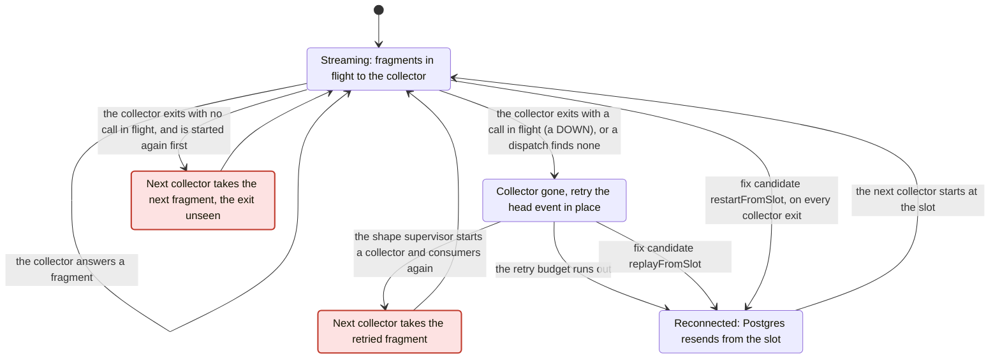
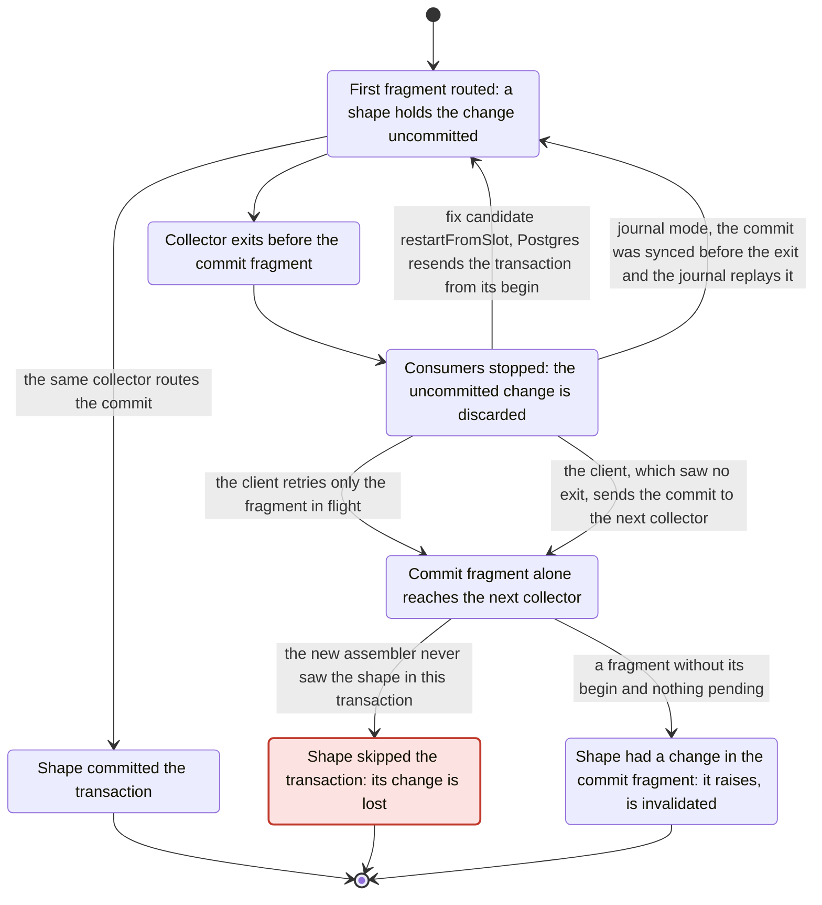
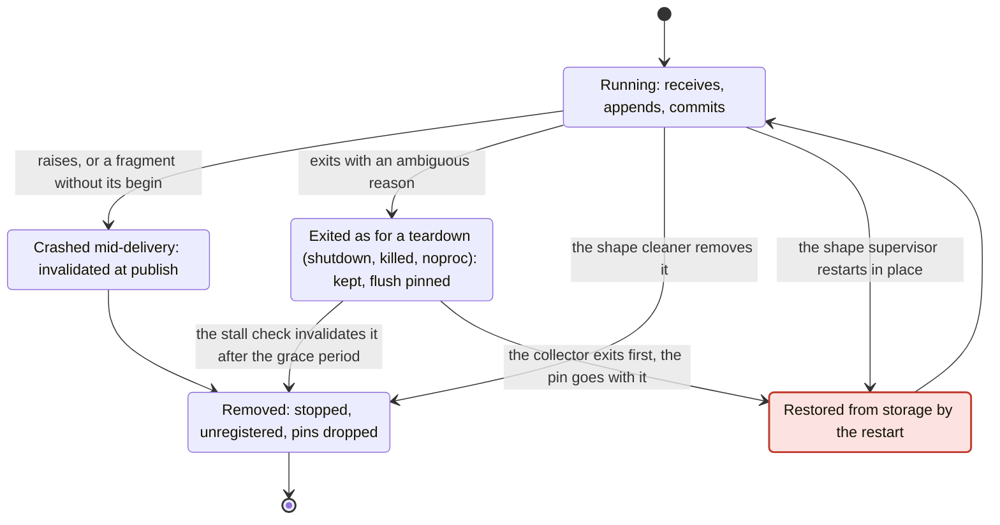

# Replication flush statecharts

Written by hand from `ReplicationFlush.tla`. The red states are where `NoLostChange` breaks on the code.

## The replication client and the collector it dispatches to

## A transaction of two fragments across a collector exit

## A shape's consumer

